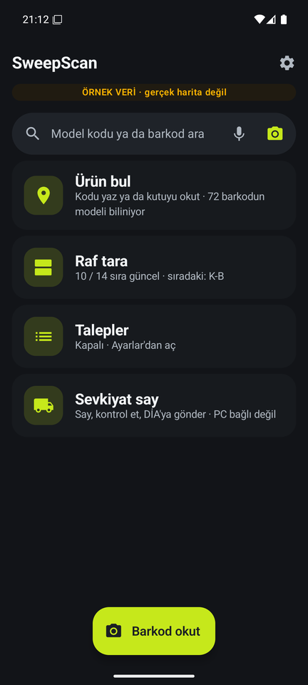
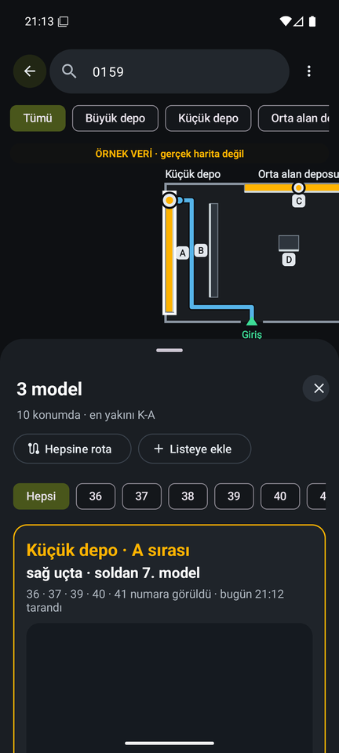
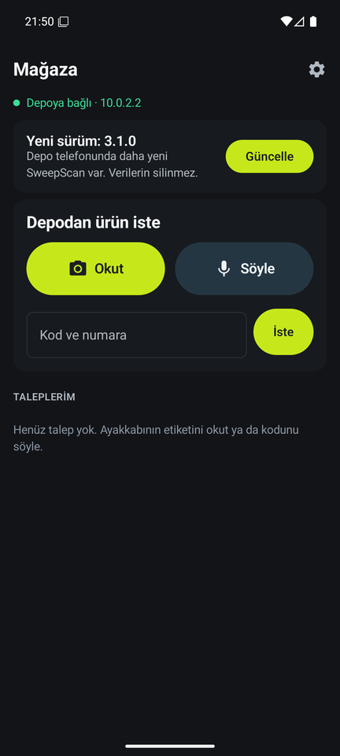
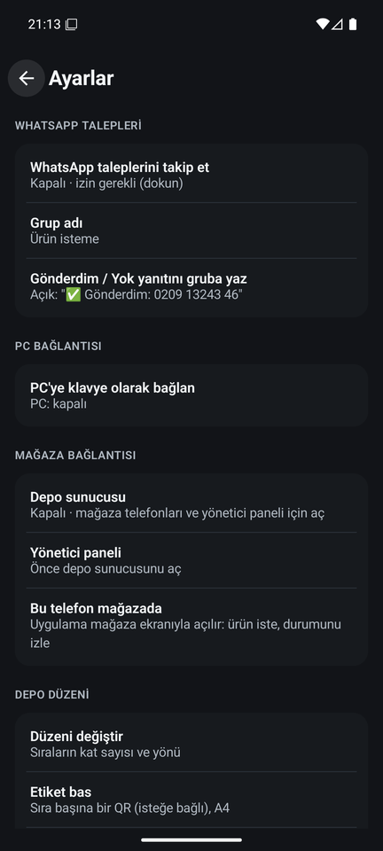

# SweepScan

Turn a phone into a trigger-free, multi-barcode scanner that **counts physical boxes**, then types
the results into any PC program over Bluetooth, the way a USB barcode gun does.

Built for receiving shoe deliveries in a retail stock room: 300–600 boxes a week were scanned one
by one with an old barcode gun into the ERP (DİA). With SweepScan you sweep the phone over the
stacked boxes, review the count, and send it.

<p>
  
  
  
  
</p>

*Screens from the sample data (Örnek veri). Download the APK from
[Releases](../../releases/latest); a one-page overview is attached there as a PDF.*

## Using it

The app opens on a home screen built around three jobs:

| Job | What you do | What you get |
|---|---|---|
| **Ürün bul** (find a product) | type a model code, or tap the camera and point it at any box | "Büyük depo · 3. sıra · ortalarda · alttan 2. raf · 39 ×2", the shelf's photo from the last sweep, the plan with the place lit and the route from the entrance, a 3D flight from the entrance to the shelf, *find in camera* |
| **Raf tara** (sweep rows) | pick a row from the list (the next one is suggested), sweep it left to right, *Bitir* | the map stays current; what changed (+new / −gone), Undo, next row |
| **Talepler** (requests) | nothing: requests in the shop floor's WhatsApp group arrive as notifications | "0209 13243 → Büyük depo · 3. sıra · ortalarda"; *Sent* / *Not there* reply in the group with one tap (or swipe the card right / left); a queue with waiting times and today's numbers |
| **Sevkiyat say** (count a delivery) | sweep the delivered boxes, review | the count by model, colour and size; the barcodes typed into the ERP over Bluetooth, with live progress in the status bar |
| **Mağaza** (shop-floor phone) | scan the shoe, or say / type its code and size, *İste* | the depot phone gets it with its place; this phone shows *Alındı → Bakılıyor → Gönderildi / Yok* live |
| **Depo paneli** (shop PC) | open the address shown in Settings → *Mağaza bağlantısı* in a browser | today's numbers, the live queue with Sent / Not there, requests by hour, top models, the stock rooms in 3D |

The depot phone is the server: shop-floor phones find it on the shop's Wi-Fi (mDNS) and use a
4-digit PIN. No account, no cloud, nothing leaves the shop.

A **home-screen widget** shows how many requests wait and starts *read a box* or *search* in one
tap. **Presentation mode** (Settings) runs the whole app on sample data with a rehearsal WhatsApp
group, for demos and filming; nothing reaches the real group. The WhatsApp automation only ever
answers in the configured group conversation; 17 scenarios with fake notifications check it.

No labels are needed: the order a row is swept in says where along the row a model stands.
Settings (WhatsApp requests, PC connection, layout, labels, data import/export, backup, sample
data) are in one screen; *Örnek veri* shows the whole app without the shop. Rollout, test
checklist and CV notes (Turkish): [`docs/yayin-ve-cv.md`](docs/yayin-ve-cv.md). Licence: MIT.

## The problem that makes this interesting

A shoe-box barcode identifies a **variant** (model + colour + size), not a box. Two black size-38
boxes carry the same barcode, and both must be counted. Reading barcodes is solved; *counting
boxes* from a moving camera is not:

| Situation | Naive "unique barcodes" | Naive "every decode" | Value + time window (most SDKs) | SweepScan |
|---|---|---|---|---|
| Two identical boxes stacked | 1 ❌ | dozens ❌ | 1 ❌ | 2 ✅ |
| Same box stays in view for 3 s | 1 ✅ | dozens ❌ | 2+ ❌ | 1 ✅ |
| Box leaves the view and comes back | 1 ✅ | dozens ❌ | 1–2 | 1 ✅ |

The design choices are backed by a research report (sources included):
[`reports/Ayakkabı kutusu barkod sayım sistemi.md`](reports/) (Turkish).

## How it works

```
CameraX Preview + ImageAnalysis (16:9, 1080p–4K YUV) ── Camera2 capture results (exposure, ISO, focus, zoom)
  ├─▶ ML Kit ─────────── decoded barcodes + barcodes located but not decoded
  ├─▶ zxing-cpp ──────── retries the located-but-undecoded crops ("rescue")
  ├─▶ ReadFilter ─────── digits only, 8/13 long, not touching the frame edge, one read per label
  ├─▶ OpenCV LK flow ─── scene translation between frames (camera-motion compensation)
  └─▶ BarcodeTracker ─── one track per physical box ─▶ ScanSession ─▶ review ─▶ HID keyboard ─▶ PC (DİA)
```

`BarcodeTracker` (pure Kotlin, unit-tested on the JVM):

1. **Scene motion.** While the phone sweeps, all labels shift together. The shift comes from voting
   over (track, detection) pairs that share a value when there is enough evidence, otherwise from
   optical flow, otherwise from the last velocity. Integrating it gives scene coordinates that stay
   valid while no label is in view (BoT-SORT's camera-motion compensation idea).
2. **Two-stage association (ByteTrack idea).** Decoded detections are matched first; barcodes that
   were located but not read keep the remaining tracks alive without voting. Gates scale with the
   barcode's own width and height, so vertically stacked twins never merge.
3. **Temporal voting per track.** A track is counted once, after ≥3 decodes that ≥60 % agree.
   Rejected reads (wrong length, frame edge) never vote — decoders return wrong values that pass
   check digits, and partial barcodes at the edge.
4. **Re-identification.** Lost tracks are kept in scene coordinates for 5 s; the same value
   re-appearing where that box should be is the same box.
5. **Co-visibility.** Two tracks ever seen in the same frame are, by definition, two boxes.
6. **Undercount warnings.** Labels located but never read, and tracks read too few times to
   count, are reported (never counted, once per spot) so a column can be rescanned.
7. **Holding still.** A lost track stays re-identifiable for as long as the view has not moved
   away (up to 60 s), so a label that drops out while the phone is held on a column is not
   counted twice.

Counting works in **sweeps**: everything since scanning last started. Pausing shows the sweep's
count (compare it with a count by eye); a long press on *Undo* deletes the sweep so the column
can be scanned again.

## Camera

The real limit is pixels per bar and motion blur, not the tracker. A 13-digit Code 128 on a 5 cm
label has ~0.41 mm bars; ML Kit wants ≥2 px per bar, so a 1080p frame reads only ~39×22 cm of labels.
Sweep **columns vertically** (along the bars), down one column and up the next, and keep exposure short:

- **Exposure:** short 4 ms by default (since 0.3.7), also 0.5–2 ms, Auto and 30 fps −1.5 EV — via
  Android 16 AE exposure-time priority, else manual exposure with an ISO loop on label brightness,
  else the 30 fps fallback. On the S23 Ultra, auto exposure picks 20 ms indoors and read 17–60 % of
  frames while sweeping; 4 ms read 83 %.
- **Zoom:** automatic by default (`AutoZoom`): one step up when the barcodes stay under ~260 px for
  about a second, one step down above ~700 px, applied only while no track is on screen. On the
  first frame captured at a new zoom (by hand or automatic) the tracker rescales everything it
  remembers about the image centre, so labels counted before the zoom are not counted again. Manual 1× / 1.5× / 2× / 3× on the screen edge;
  3× switches to the telephoto lens (sharp from 40 cm). At 1× the phone has to be so close that
  autofocus keeps hunting.
- **Focus:** continuous (tap to focus) / continuous centre-weighted / fixed 0.2–1.2 m.
- **Settings tour** (⚙): one recording, the app switches zoom × exposure every 20 s while you keep
  sweeping; `tools/latency_report.py` compares the steps.
- **Hints:** "BLURRY: sweep top to bottom" from gyroscope rate × real exposure × focal length;
  "SLOW DOWN" above 60 °/s.
- **Camera info** (⚙) shows what the phone exposes to apps; the full Camera2 dump is written to
  `Download/SweepScan/caps-*.json`.

## Sending to the PC

The phone registers as a Bluetooth keyboard (`BluetoothHidDevice`, Android 9+). A keyboard cannot
see whether the ERP accepted a line, so:

- each key is released explicitly; nothing is ever erased (no Backspace retries);
- if the link drops mid-barcode, the line becomes **uncertain**, sending stops, and the user checks
  DİA ("it is in DİA" / "send again");
- default flow is **count first, then send**: *Finish* → review → *Send to DİA* (refused without a
  connected PC; a CSV backup is written first);
- pacing is configurable (hold 25/40 ms, 1.5–3 s per barcode, +50 % for new values, slow-PC ×2);
- *PC → Test: 100 barcodes* types numbered codes into Notepad to tune the pacing.

Longer term, DİA's own web-service API (`scf_barkod_okut` + `scf_malzeme_fisi_ekle`, `turu = 1`)
would replace the keyboard entirely; it needs an API key from DİA.

## Field data loop

1. ⚙ → *Start field recording*, named after the column/setting (e.g. `C3-short1ms-vertical`).
   `Download/SweepScan/` gets a JSONL log (meta line with device, settings, tracker config and
   camera capabilities; one line per frame with detections, verdicts, motion, capture metadata,
   gyro, luma and timings; HID and session events) and sampled analysed frames as PNG.
   Motion is logged both as the translation the tracker uses and as a RANSAC similarity
   (rotation + scale), so a recording can later replay a richer motion model.
2. Copy the `.jsonl` files to `core/src/test/resources/field/`; add `<name>.expected` with the true
   box count (optionally `<barcode> <qty>` lines).
3. `gradlew.bat :app:testDebugUnitTest --tests "*ReplayTest*" -i` replays every log under twelve
   tracker configurations (default, as recorded, v0.2, no flow prior, long re-identification,
   no hold-while-still, no twin absorption, no re-identification, loose lengths, no edge rule,
   GS1 check…) and prints count errors.
4. **Watch a recording:** open `tools/viewer.html` in a browser and drop the `SweepScan` folder on
   it. It plays the analysed frames back with the boxes the app drew, marks every count and every
   unread label on a timeline, and compares the count with the `.expected` file barcode by
   barcode. One file, no install, nothing leaves the computer.

Field-test checklist (Turkish): [`docs/saha-testi.md`](docs/saha-testi.md). DİA API access request
drafts (Turkish): [`docs/dia-api-request.md`](docs/dia-api-request.md).

## Location map: "where is model 0159 2000?"

The second problem in the same stock room: nobody knows where a model is. Three depots, racks
in rows of columns, 4 shelves high. SweepScan builds the map from the sweeps it already does:

```
Column QR label (LOCB307) ─▶ ColumnRecorder ── boxes counted until the next label ─▶ Sweep (append-only)
                                                                                   ├─▶ current contents (sighting)
Label text "0169 051 KAHVE 36" ─▶ OCR ─▶ ModelVotes (2 of 3 agree) ─▶ barcode → model
Search "0159 2000" ─▶ columns ─▶ RouteFinder (corridor graph, Dijkstra; pick list: NN + 2-opt) ─▶ PlanView
```

- **Map mode** on the scan screen: read the column's QR label in the middle of the picture,
  sweep the column; the next label saves it and shows what changed (+new / −gone) with Undo.
- **Find location:** model code (or part), barcode or location; every column holding it on the
  plan, the nearest chosen, the walking route from the entrance, the rack seen from the front;
  each column's contents (top to bottom) and history; a pick list in walking order; **find in
  camera** marks the wanted boxes live.
- **Trust:** sweeps are never overwritten (`sweep`, `sweep_line`; Room schema exported, the
  0.6 → 0.7 migration tested on the device), the plan shows how fresh each column is, the
  overview lists what to sweep next.
- **Labels:** A4 PDF with vector QR codes (ZXing, level Q), printed from the phone.
- **Try it without the shop:** Find location → menu → *Show sample data* (a separate demo
  database; the real map is untouched).

Design and research (Turkish): [`docs/konum-haritasi.md`](docs/konum-haritasi.md),
[`reports/`](reports/). Changes: [`CHANGELOG.md`](CHANGELOG.md).

## Build & install

Requires Android Studio (or its bundled JDK) and the Android SDK.

```bash
.\build.bat      # unit tests + lint + release APK -> dist\SweepScan.apk
.\install.bat    # installs on the USB-connected phone, grants permissions, starts the app
```

`build.bat` uses Android Studio's JDK, so an old `java` on the PATH doesn't matter. The release
build is shrunk by R8 (24 MB with Compose; keep rules in `app/proguard-rules.pro`) and signed with
the debug key (it is not a store build). Step-by-step phone setup in Turkish:
[`docs/kurulum.md`](docs/kurulum.md).

### Structure

| Module | What is in it |
|---|---|
| `:core` (plain Kotlin, no Android) | barcode tracker and its rules, stock-room layout and routes (Dijkstra + 2-opt), sweep diff, shelf level from tilt, the 3D scene (instancing data, five-face meshes, a binary glTF writer, the camera's flight path, picking), request text parser; 126 JVM tests incl. replayed phone recordings |
| `:app` | CameraX + ML Kit + zxing-cpp + OpenCV pipeline, Room database, Filament (gltfio) for the 3D flight, depot server (LAN, mDNS, web panel with a WebGL2 3D view) and shop-floor client, screens |

Screens are Jetpack Compose + Material 3 on one design system (`ui/theme`: colours, type, shapes,
components); the camera and the 2D plan stay Views and sit inside them. The shop-floor
screen is MVVM (`ShopViewModel`, `StateFlow`).

## Testing

Three layers, because the emulator's camera cannot show what breaks reads on the phone (motion
blur, defocus, sensor noise):

1. **Phone recordings, replayed on every build.** `phone-*.jsonl` in `core/src/test/resources/field/`
   come from the S23 Ultra; `ReplayTest` scores every tracker variant per barcode (over + under) and
   fails if the default configuration does worse than the phone did live.
2. **Decode benchmark on real labels**, on the phone or an emulator: `tools\decode_bench.bat [serial]`.
   `tools/make_label_corpus.py` cuts labelled crops out of phone recordings; `DecodeBenchmarkTest`
   runs them through the app's own ML Kit and zxing-cpp settings, clean and with blur across and
   along the bars, defocus, distance and noise, plus the auto / 4 ms / 2 ms exposure trade-off.
   Uses its own package (`com.sweepscan.debug`), so the real app and its count are never touched.
3. **Emulator scenes** for the counting logic (below).
4. **Device tests against the R8 build:** `gradlew -Pr8test :app:assembleFullR8test
   :app:assembleFullR8testAndroidTest`, then `am instrument` (database migrations,
   screens, the closable answer sheet, the 3D flight rendered off screen, shelf photos, the depot server end to end, OpenCV
   optical flow, the decode and OCR benchmarks), so nothing a library needs at run time was
   removed by R8.

### Emulator scenes

The whole chain (CameraX → ML Kit → tracker → count → log → replay) runs on the Android emulator.
`tools/make_scene.py` draws a wall of 40 stacked shoe boxes after photos of the stock room (an
ordinary delivery, damaged labels, and runs of identical boxes); `tools/make_camera_path.py`
sweeps the emulator's camera over it like a person would; `tools/run_emulator_matrix.py` records
every scene × path and scores the count against the scene's ground truth. Seven of the nine runs
count exactly; the two that don't are documented, with causes, in
[`docs/emulator-test.md`](docs/emulator-test.md). Four of the recordings are replayed by
`ReplayTest` on every build, and `WarehouseSimulationTest` sweeps 300 boxes at phone frame rate.

## Status

Prototype (v0.7.0; the location map above is new in 0.6–0.7). Run on the Galaxy S23 Ultra (Android 17) since 16 Nov: 25–30 analysed frames
per second; a 12-box column swept once counted 12 of 12. What the phone taught, and what changed:

- **Camera:** auto exposure (20 ms) smeared the bars and 1× zoom forced the phone so close that
  focus kept hunting: defaults are now 4 ms and automatic zoom (`AutoZoom`).
- **Going back up a column** counted the top boxes again. Cause, measured on the recordings: the
  label-vote shift is noisy on the phone (ML Kit returns a thin scan line that jumps along the
  bars), so remembered positions drifted 1–2 barcode heights. Fixes: memory for the whole sweep,
  flow-first shift, and neighbour-aware re-identification (`TrackerConfig.neighbourReid`). Replays
  of every recording: per-barcode error 27 (live) → 1.
- **Gyroscope:** now sampled at 200 Hz and the rotation between frames logged (`gs`); as a motion
  fallback it was worse than the velocity guess on the old logs, so `gyroFallback` stays off.
- **Appearance fingerprints (MediaPipe, MobileNet-V3):** tried, then removed in 0.7.0 (it was off, and
  added 18 MB to the APK): on real label crops the
  generic model scored the same barcode and different barcodes alike (median 0.59 vs 0.59).
- **New screen:** one-tap zoom and torch, a settings sheet, big pause button; settings tour.
- **0.5.0:** OCR fallback (ML Kit text recognition on the device): when neither decoder reads the
  bars, the printed number is read and accepted only with a valid check digit; on real phone
  frames it recovered 20 % of unreadable labels, at ~120 ms per region, so it runs on a fairly
  still view every third frame. Volume keys pause/resume, green flash on each count, "move
  closer / back" hints, review screen with one send button and a 5 s countdown to click into DİA,
  first-run guide.
- **0.5.1–0.5.2:** live FIFO typing (each counted box is queued and typed at the chosen speed:
  safe / normal / fast), one review screen with per-line status, last five digits emphasised
  everywhere. 0.5.2 fixes a crash on "Bitir" (a Material Chip cannot wrap text) and keeps the
  controls usable while paused. `ScreensSmokeTest` now presses every control on both screens on
  the phone (plain instrumentation: Espresso 3.6 fails on Android 17) and runs with
  `tools\decode_bench.bat` before each install.

Not yet verified: Bluetooth typing into DİA (pairing must start from Windows while the app is open,
see `docs/saha-testi.md`) and a full delivery against the existing barcode gun.

## Known limitations

- The motion model is a 2D translation: rotation, walking toward the boxes and parallax between
  near and far stacks are not modelled yet (planned: RANSAC similarity/homography per column).
- Going back over counted boxes is safe within a sweep (memory lasts until Pause; neighbours
  re-identify a box whose remembered spot has drifted); after a Pause the app has forgotten them.
  Two adjacent columns with the same products in the same order are kept apart only by their
  sideways distance; this has been tested in simulation, not yet on the phone.
- Pausing (or changing the resolution) resets tracking: labels already counted that are in view
  when scanning resumes are counted again. Resume on uncounted boxes, or delete the sweep.
- An entry already typed into the PC must be fixed in the PC program by hand.
- Android unregisters a Bluetooth keyboard app that leaves the foreground; keep SweepScan open
  while sending.
